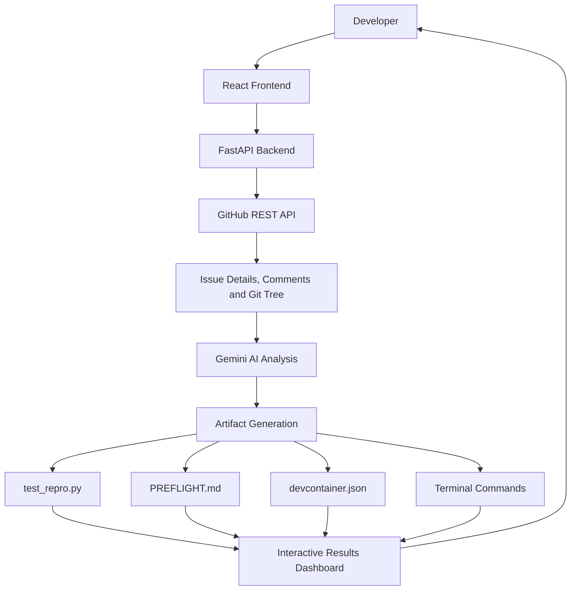

# PreFlight Sandbox

**AI-Powered Automated Execution Layer for First-Mile Open-Source Contributions**

PreFlight Sandbox is an AI-powered developer tool that transforms a GitHub issue into an actionable debugging and reproduction workspace. It analyzes issue context and repository structure to help developers understand the affected code, reproduce reported bugs, and prepare an isolated environment for investigation.

## Table of Contents

- [Overview](#overview)
- [Problem Statement](#problem-statement)
- [Solution](#solution)
- [How It Works](#how-it-works)
- [Key Features](#key-features)
- [System Architecture](#system-architecture)
- [Technology Stack](#technology-stack)
- [Project Structure](#project-structure)
- [Prerequisites](#prerequisites)
- [Installation and Setup](#installation-and-setup)
- [Environment Configuration](#environment-configuration)
- [Generated Artifacts](#generated-artifacts)
- [Demo Scenarios](#demo-scenarios)
- [Future Improvements](#future-improvements)

## Overview

Contributing to open-source software can be difficult for developers who are unfamiliar with a project's internal architecture. Even after finding a suitable issue, contributors must understand the codebase, configure dependencies, identify the relevant implementation, and reproduce the reported behaviour.

PreFlight Sandbox reduces this initial friction by combining GitHub repository analysis with AI-assisted technical reasoning.

Given a GitHub issue URL, the system generates a structured set of development resources that guide contributors from understanding the problem to preparing a reproducible debugging workflow.

## Problem Statement

First-time open-source contributors frequently encounter three major obstacles:

- **Environment Setup Complexity:** Installing dependencies and configuring a project's development environment can be time-consuming and error-prone.
- **Codebase Complexity:** Large repositories make it difficult to identify relevant modules, functions, and data flows associated with a reported issue.
- **Bug Reproduction Difficulty:** Issue descriptions may not provide sufficient instructions or test cases to reproduce the reported failure locally.

These obstacles create a barrier between discovering an open-source issue and making a meaningful contribution.

## Solution

PreFlight Sandbox provides an AI-assisted preparation layer that converts a GitHub issue into a structured debugging plan.

The system analyses available issue information and repository metadata, then generates:

1. **Target Code Identification:** Highlights the relevant module, file, and function areas associated with the reported issue.
2. **Reproduction Test Generation:** Produces a `test_repro.py` file intended to demonstrate the reported failure through a failing test.
3. **Technical Mission Dossier:** Creates a `PREFLIGHT.md` document containing repository context, architectural explanations, data-flow diagrams, root-cause hypotheses, and a step-by-step investigation guide.
4. **Development Container Configuration:** Generates a `.devcontainer/devcontainer.json` configuration to help establish an isolated development environment.
5. **Interactive TDD Blueprint:** Provides terminal commands and a suggested workflow for setting up the repository, running the reproduction test, and investigating the failure.

The objective is to help developers begin debugging with a clearer understanding of the codebase and a repeatable starting point.

## How It Works

The application follows a pipeline from issue submission to generated development artifacts.

### 1. Issue Submission

The developer provides a GitHub issue URL through the frontend dashboard. Curated demonstration scenarios are also available for exploring the workflow.

### 2. GitHub Data Retrieval

The FastAPI backend communicates with the GitHub REST API to retrieve relevant information, including:

- Issue description and metadata
- Available issue comments
- Repository Git tree and file structure

This information establishes the context needed for subsequent analysis.

### 3. Repository and Issue Analysis

The backend combines the retrieved repository context with AI-assisted analysis using Google's Gemini API. The objective is to connect the reported behaviour with potentially relevant files, modules, and functions.

### 4. Artifact Generation

The analysis is used to prepare a collection of development resources:

- A candidate reproduction test
- A technical briefing in `PREFLIGHT.md`
- A development container configuration
- A terminal-based reproduction and debugging workflow

The generated material serves as a starting point for investigation and may require validation against the actual repository.

### 5. Interactive Results

The React frontend presents the generated resources in a tabbed code viewer. Developers can inspect the outputs, copy commands, and download generated files.

This creates a single interface for preparing the first stages of an open-source contribution.

## Key Features

### AI-Assisted Repository Analysis
Uses issue details and repository metadata to help identify relevant code and understand the reported problem.

### Automated Reproduction Test Drafting
Generates a proposed test case designed to expose the reported failure and support a test-driven debugging workflow.

### Architecture and Context Documentation
Produces a technical dossier with explanations, Mermaid diagrams, investigation guidance, and potential root-cause analysis.

### Isolated Environment Preparation
Generates a development container configuration to support reproducible development environments.

### Interactive Developer Dashboard
Provides a dark-themed interface with tabbed artifact viewing, code inspection, command copying, and file downloads.

### Curated Demonstration Scenarios
Includes predefined examples to demonstrate the workflow without requiring every demonstration to start with a new issue URL.

### Resilient Demonstration Flow
Includes a fallback synthesis mechanism intended to help maintain the demonstration experience when external API limits are encountered.

## System Architecture

The application consists of two main components: a React-based frontend and a Python-based backend.



### Frontend

The frontend provides the developer-facing interface for submitting issues, exploring generated results, and accessing the output files.

### Backend

The backend handles request processing, GitHub API communication, AI-assisted analysis, and generation of the output artifacts.

### External Services

- **GitHub REST API:** Supplies issue details, comments, and repository tree information.
- **Google Gemini API:** Supports contextual analysis and generation of technical resources.

## Technology Stack

| Component | Technologies |
|---|---|
| Frontend | React 18, Vite |
| Styling | Tailwind CSS |
| Icons | Lucide React |
| Backend | Python 3.11+, FastAPI |
| ASGI Server | Uvicorn |
| HTTP Client | HTTPX |
| AI Integration | Google GenAI SDK |
| Repository Data | GitHub REST API v3 |
| Development Environment | Python virtual environment, VS Code Dev Containers |

## Project Structure

```text
Issue-X/
├── backend/
│   ├── main.py
│   ├── requirements.txt
│   ├── .env.example
│   └── .env
├── frontend/
│   ├── index.html
│   ├── package.json
│   ├── vite.config.js
│   ├── tailwind.config.js
│   ├── postcss.config.js
│   └── src/
│       ├── App.jsx
│       ├── index.css
│       └── main.jsx
├── .gitignore
└── README.md
```

The `.env` file contains local configuration and should not be committed to version control. Use `.env.example` as the configuration template.

## Prerequisites

Ensure the following tools are installed:

- Python 3.11 or later
- Node.js and npm
- Git
- A Google Gemini API key
- A GitHub personal access token if required by the configured API access workflow

## Installation and Setup

### 1. Clone the Repository

```bash
git clone https://github.com/riddh619/Issue-X.git
cd Issue-X
```

### 2. Configure the Backend

Open a terminal in the project directory.

```bash
cd backend
python -m venv .venv
```

Activate the virtual environment.

**Windows PowerShell:**

```powershell
.\.venv\Scripts\Activate.ps1
```

**Windows Command Prompt:**

```bat
.venv\Scripts\activate.bat
```

**Linux or macOS:**

```bash
source .venv/bin/activate
```

Install the dependencies:

```bash
python -m pip install -r requirements.txt
```

### 3. Configure Environment Variables

Create a `.env` file inside the `backend/` directory using `.env.example` as a reference.

Add the credentials required by the application:

```env
GEMINI_API_KEY=your_gemini_api_key
GITHUB_TOKEN=your_github_token
```

Replace the placeholder values with your own credentials. Follow the application's expected configuration and never commit actual API keys or access tokens.

### 4. Start the Backend Server

From the `backend/` directory, run:

```bash
python -m uvicorn main:app --host 127.0.0.1 --port 8001 --reload
```

The backend will be available at:

- API base: `http://127.0.0.1:8001`
- Interactive API documentation: `http://127.0.0.1:8001/docs`

Keep this terminal running.

### 5. Configure the Frontend

Open a second terminal from the project root:

```bash
cd frontend
npm install
```

### 6. Start the Frontend Server

```bash
npm run dev -- --host 127.0.0.1 --port 5174
```

Open the application in your browser:

`http://127.0.0.1:5174`

The Vite development configuration provides the frontend's backend proxy. Keep both development servers running while using the application.

## Generated Artifacts

| Artifact | Purpose |
|---|---|
| `test_repro.py` | Proposed test for reproducing the reported failure |
| `PREFLIGHT.md` | Technical briefing, architectural context, investigation guidance, and data-flow diagrams |
| `.devcontainer/devcontainer.json` | Development container configuration |
| Terminal commands | Instructions for repository setup and the reproduction workflow |

These artifacts are intended to accelerate investigation. Generated tests, architectural interpretations, and root-cause hypotheses should be reviewed and verified before being relied upon.

## Demo Scenarios

The project includes curated examples associated with the following repositories and issues:

- [psf/requests — Issue #5491](https://github.com/psf/requests/issues/5491)
- [pallets/flask — Issue #4523](https://github.com/pallets/flask/issues/4523)
- [encode/httpx — Issue #1230](https://github.com/encode/httpx/issues/1230)
- [fastapi/fastapi — Issue #3112](https://github.com/fastapi/fastapi/issues/3112)

These examples can be used to explore the application's workflow and generated outputs. Availability and output quality depend on the configured services and the implementation of each demonstration scenario.

## Future Improvements

Potential areas for further development include:

- More precise mapping between issue descriptions and relevant code locations.
- Automated validation of generated reproduction tests.
- Support for additional programming languages and testing frameworks.
- Improved handling of complex dependency configurations.
- More robust verification of generated development container settings.
- Integration with GitHub pull requests and contribution workflows.
- Better observability for failed API requests and incomplete analyses.

## Project Objective

PreFlight Sandbox aims to reduce the initial effort required to contribute to open-source software by turning an unfamiliar GitHub issue into a structured, actionable debugging starting point.

By combining repository context, AI-assisted analysis, test generation, and environment preparation, the project helps developers move from issue discovery toward reproducible investigation with greater clarity.
